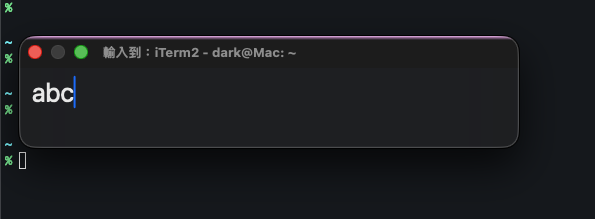
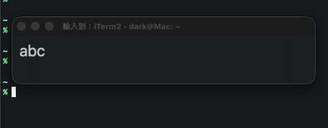
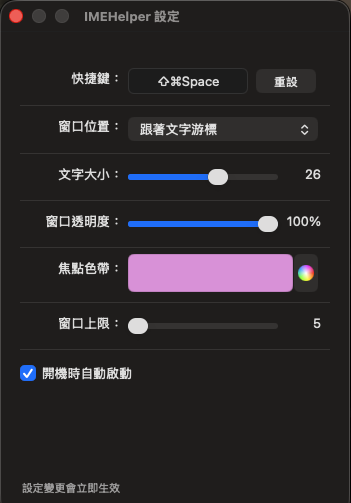
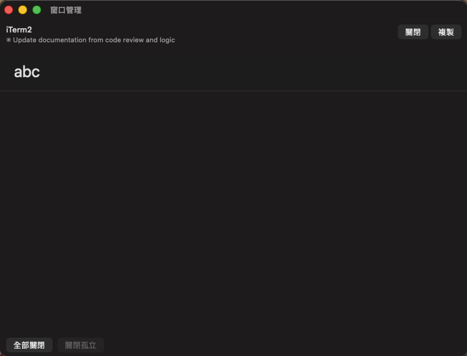

[English](README.md) | [繁體中文](README.zh-TW.md)

# IMEHelper

A lightweight macOS utility that provides a floating input panel for typing in CJK and other IME-dependent languages, then inserting the text back into any app.

**[Download Latest Release](https://github.com/dark-zixin/IMEHelper/releases/latest)**

## The Problem

Many apps on macOS have poor IME support:

- **Terminal emulators** (iTerm2, Wezterm, Ghostty) — CJK input is broken or awkward over SSH
- **Remote desktop clients** (RDP, VNC, Parsec) — IME composition doesn't work properly
- **Electron apps** (ChatGPT, VS Code terminal) — backspace deletes the wrong characters, preedit text disappears
- **Other apps** — some simply don't support IME at all

This affects **Chinese, Japanese, Korean, Vietnamese**, and other languages that require IME composition.

## How It Works

1. Press a global hotkey (default: `Cmd+Shift+Space`) in any app
2. A floating input panel appears — type freely with full IME support
3. Press `Enter` to insert the text back into the original app

Each window and tab gets its own independent draft, so you can switch between contexts without losing text.

> The text is injected via clipboard (Cmd+V). By default, your original clipboard content is saved and restored after injection. For remote desktops or slower apps, enable **Keep Submitted Text** in Settings to leave the submitted text on the system clipboard instead. The most recent submission can also be copied again from the menu bar for 10 minutes after sending.

## Screenshots

| Focused | Unfocused |
|---------|-----------|
|  |  |

| Settings | Panel Manager |
|----------|---------------|
|  |  |

## Features

- **Floating input panel** with translucent glass effect
- **Per-window/tab drafts** — each context keeps its own text
- **Smart detection** — event-driven tab/window change detection
- **Custom hotkey** — configure your preferred shortcut
- **Panel management** — view, copy, and manage all active panels
- **Safer text delivery** — waits for the original app to become active and avoids overwriting clipboard changes made by other apps
- **Optional clipboard retention** — enable **Keep Submitted Text** when an app needs more time to read the clipboard
- **Submission recovery** — copy the most recently submitted text again from the menu bar for up to 10 minutes
- **Focus indicator** — top edge color strip + opacity change shows focus state
- **Customizable** — panel position, font size, opacity, focus strip color
- **Localized** — English and Traditional Chinese
- **Offline Cangjie lookup** — a separate compact window with complete radicals, per-character saving, recent characters, and saved-list management

## Affected Languages

IMEHelper helps users of any language that requires IME composition:

| Language | Common Issues |
|----------|--------------|
| Chinese | Preedit text invisible, composition broken in terminal |
| Japanese | Candidate window at wrong position, preedit disappears on modifier key |
| Korean | Double space on spacebar, text invisible during composition, shortcuts eaten by IME |
| Vietnamese | Characters lost during Telex/VNI composition, characters doubled |

## System Requirements

- macOS 14.0 (Sonoma) or later
- Accessibility permission required (for hotkey detection and cursor position)

## Installation

1. Download the latest `.dmg` from [Releases](../../releases)
2. Open the DMG and drag `IMEHelper.app` to Applications
3. Launch IMEHelper — it appears as a keyboard icon in the menu bar
4. Grant Accessibility permission when prompted (System Settings > Privacy & Security > Accessibility)

> **Note:** The app is signed and notarized by Apple, so it opens directly. No right-click "Open" or security workaround is needed on first launch.

## Usage

| Action | How |
|--------|-----|
| Open input panel | Press `Cmd+Shift+Space` (or your custom hotkey) |
| Send text | Press `Enter` |
| Toggle panel visibility | Press hotkey again when panel is visible |
| Clear text | Press `ESC` once |
| Close panel | Press `ESC` twice (or once if empty) |
| Settings | Click menu bar icon > Settings |
| Keep submitted text on clipboard | Click menu bar icon > Settings > enable **Keep Submitted Text** |
| Copy the most recent submission | Click menu bar icon > **Copy Last Submission** (available for 10 minutes after sending) |
| Panel manager | Click menu bar icon > Panel Manager |
| Cangjie lookup | Click menu bar icon > Cangjie Lookup |

## Cangjie Lookup

Type or paste text to look up each character's Cangjie 5 radicals. All source codes are retained, with regular codes before codes starting with X. During IME composition, the last committed results remain visible; results update after the character is committed. Choose Save beside a character to keep it. Saving again moves it to Recent without creating a duplicate. Saved is feedback for that action; editing the input restores the Save button.

Expand or collapse Saved to view your list. Recent shows the first three characters with their radicals; select a character in Other to see its codes. Long codes scroll within their existing region, and the third recent character may also require scrolling. Manage lets you delete recent or other characters after confirming the specific character. The window can be moved, resized, and pinned. If taller content pushes it away from the screen's bottom edge, it returns to the last manually chosen position when the smaller window fits there again.

The implementation ignores the input-panel hotkey while Cangjie Lookup receives keyboard input and preserves its existing behavior when another app has focus. The menu entry and hotkey suppression wiring do not yet have direct regression tests. Selecting and copying radicals, plus paste, cut, select all, undo, and redo in the input field, have been verified through offline AppKit component entry points only; actual keyboard event delivery has not been tested. Actual IME, cross-app, multiple-display, and full-screen behavior also still require validation in the intended environment.

### Saved-list recovery

The file is stored at `~/Library/Application Support/IMEHelper/cangjie-list.json`. If reading fails, Saved unavailable is shown; saving and list management stay disabled until the list loads successfully, including after closing and reopening the lookup window. An unknown count is not shown as zero. Recovery help opens the offline instructions included with the app.

Quit every IMEHelper process first. Open the folder with Finder's Go to Folder, copy the original file elsewhere as a backup, then check permissions or JSON. If a newer version created it, use a compatible version rather than editing the format version. Do not delete or replace the original with an empty file. After repair, run one IMEHelper, reopen Cangjie Lookup or choose Retry. See the [offline recovery instructions](IMEHelper/en.lproj/CangjieRecovery.html) for details.

Legacy passage-based lists are converted to individual characters when read. Reading does not change the file; the first successful save or deletion writes the new format. Passage grouping is not retained, and no automatic backup is created. Back up the old file first if you need those groups.

## Known Limitations

- Run only one IMEHelper process at a time in the same macOS account, including copies of the same version. Concurrent saves are not protected against overwriting another process's newly saved characters.
- Text injection uses the clipboard (Cmd+V). By default, original clipboard content is saved and restored, but clipboard-sensitive apps may be affected during the brief injection window. Enabling **Keep Submitted Text** intentionally replaces the previous clipboard content.
- The input panel requires Accessibility permission. Some enterprise-managed Macs may restrict this.
- Tab identification relies on Accessibility API attributes, which vary by app. Some apps may not be distinguishable at the tab level.

## Building from Source

1. Clone the repository
2. Open `IMEHelper.xcodeproj` in Xcode
3. Build and run (requires macOS 14.0+ SDK)

Cangjie regression checks also require `python3`, `zsh`, and `rg` (ripgrep). Build the app first, then run `scripts/test-cangjie-models.sh <path-to-IMEHelper.app>`, `scripts/test-cangjie-ui.sh <path-to-IMEHelper.app>`, and `scripts/test-cangjie-ui-mutations.sh <path-to-IMEHelper.app>`. Output goes under the repository's `tmp/topics/11062140_cangjie_lookup/`. UI tests do not display windows. Editing-shortcut checks save and restore the system clipboard; run them while other apps are not changing it.

## Contributing

Issues and pull requests are welcome. For bug reports, please include your macOS version and the app where the issue occurred.

## License

The application code uses the [MIT License](LICENSE). Cangjie data retains its upstream licensing and is not relicensed under MIT. See [CangjieData-Notices.txt](IMEHelper/CangjieData-Notices.txt) for sources, conversion details, and the LGPL and GPL license texts.

*UI language follows system settings. English and Traditional Chinese are supported.*
