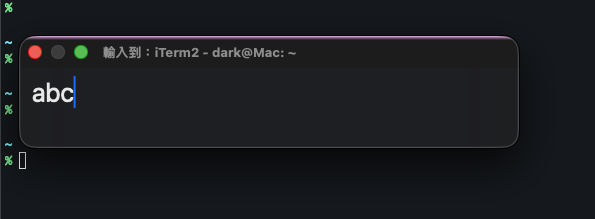
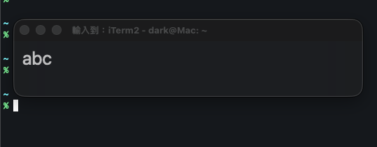
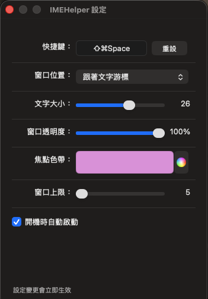
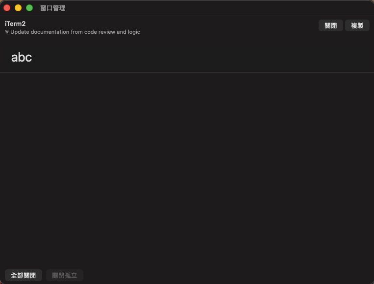

[English](README.md) | [繁體中文](README.zh-TW.md)

# IMEHelper

輕量級 macOS 工具，提供浮動輸入面板，讓你在任何 app 中使用中日韓等需要輸入法組字的語言，再將文字回填到原本的 app。

**[下載最新版本](https://github.com/dark-zixin/IMEHelper/releases/latest)**

## 解決什麼問題

許多 macOS app 無法正確處理輸入法：

- **終端機**（iTerm2、Wezterm、Ghostty）— 透過 SSH 時中文輸入異常
- **遠端桌面**（RDP、VNC、Parsec）— 輸入法組字無法正常運作
- **Electron app**（ChatGPT、VS Code 終端）— 退格鍵刪錯字元、組字文字消失
- **其他 app** — 某些 app 根本不支援輸入法

這影響**中文、日文、韓文、越南文**等需要輸入法組字的語言使用者。

## 運作方式

1. 在任何 app 中按下全域快捷鍵（預設：`Cmd+Shift+Space`）
2. 浮動輸入面板出現 — 自由輸入，完整的輸入法支援
3. 按 `Enter` 將文字回填到原本的 app

每個視窗和分頁都有獨立的草稿，切換上下文不會遺失文字。

> 文字透過剪貼簿（Cmd+V）注入。預設會先備份原本的剪貼簿內容，並在注入後還原。若是遠端桌面或反應較慢的 App，可在「設定」開啟「**保留送出文字**」，讓送出的文字留在系統剪貼簿。送出後 10 分鐘內，也可以從選單列再次複製最近一次送出的內容。

## 截圖

| 有焦點 | 無焦點 |
|--------|--------|
|  |  |

| 設定 | 視窗管理 |
|------|----------|
|  |  |

## 功能

- **浮動輸入面板** — 半透明玻璃效果
- **每個視窗/分頁獨立草稿** — 每個上下文保留自己的文字
- **智慧偵測** — 事件驅動的分頁/視窗變化偵測
- **自訂快捷鍵** — 設定你偏好的快捷鍵組合
- **視窗管理** — 檢視、複製、管理所有作用中的面板
- **更安全的文字送出** — 等待原本的 App 成為前景，並避免覆蓋其他 App 在送出期間更新的剪貼簿內容
- **選擇保留送出文字** — 目標 App 需要較長時間讀取剪貼簿時，可開啟「保留送出文字」
- **送出內容備援** — 送出後 10 分鐘內，可從選單列再次複製最近一次送出的文字
- **焦點提示** — 上邊色帶 + 透明度變化顯示焦點狀態
- **可自訂** — 面板位置、字型大小、透明度、焦點色帶顏色
- **多語系** — 英文與繁體中文
- **離線倉頡查碼** — 獨立小窗查看完整中文字根、逐字保存、近期三字與其他字管理

## 受影響的語言

IMEHelper 幫助所有需要輸入法組字的語言使用者：

| 語言 | 常見問題 |
|------|---------|
| 中文 | 組字文字不可見、終端機中輸入法組字異常 |
| 日文 | 候選窗位置錯誤、按修飾鍵時組字文字消失 |
| 韓文 | 空白鍵雙倍輸入、組字過程文字不可見、快捷鍵被輸入法攔截 |
| 越南文 | Telex/VNI 組字過程字元遺失或重複 |

## 系統需求

- macOS 14.0（Sonoma）或更新版本
- 需要輔助使用權限（用於快捷鍵偵測和游標位置）

## 安裝

1. 從 [Releases](../../releases) 下載最新的 `.dmg`
2. 打開 DMG，將 `IMEHelper.app` 拖到應用程式資料夾
3. 啟動 IMEHelper — 它會以鍵盤圖示出現在選單列
4. 依提示授予輔助使用權限（系統設定 > 隱私權與安全性 > 輔助使用）

> **注意：** app 已經過 Apple 簽署與公證，下載後可直接開啟，無須右鍵「打開」或任何安全性繞過步驟。

## 使用方式

| 動作 | 操作 |
|------|------|
| 開啟輸入面板 | 按 `Cmd+Shift+Space`（或自訂快捷鍵） |
| 送出文字 | 按 `Enter` |
| 切換面板顯示 | 面板可見時再按一次快捷鍵 |
| 清空文字 | 按一次 `ESC` |
| 關閉面板 | 按兩次 `ESC`（空白時按一次即可） |
| 設定 | 點擊選單列圖示 > 設定 |
| 將送出文字留在剪貼簿 | 點擊選單列圖示 > 設定 > 開啟「保留送出文字」 |
| 複製最近一次送出內容 | 點擊選單列圖示 >「複製上次送出內容」（送出後 10 分鐘內可用） |
| 視窗管理 | 點擊選單列圖示 > 視窗管理 |
| 倉頡查碼 | 點擊選單列圖示 > 倉頡查碼 |

## 倉頡查碼

輸入或貼上文字即可逐字查看倉頡五代字根；保留來源的全部碼，一般碼在前、X 開頭碼在後。組字選字期間維持上次已確認的結果，選字確認後才更新。每個字旁的「存」可保存該字，重存會移到近期前面而不重複占位。「已存」是這次保存成功的回饋，輸入改變後仍可再次按「存」。

「已存的字」可展開或收合；近期三字直接顯示字根，其他字點選後顯碼。長碼可在原區域內捲動，近期也可能需要捲動才看得到第三字。進入「管理」可刪近期或其他字，確認指定字後才刪除。小窗可拖動、縮放及置頂；若內容加高而被迫移離螢幕下緣，縮小且原位置放得下時會回到最後手動擺放的位置。

程式已接上「查碼窗接收鍵盤時略過原輸入面板快捷鍵、焦點在其他 app 時維持原行為」的處理；選單入口與快捷鍵抑制的接線仍沒有直接回歸測試。字根的選取與複製，以及輸入框的貼上、剪下、全選、復原與重做，目前只由未顯示視窗的 AppKit 元件入口驗證，尚未驗證實際鍵盤事件派送。真輸入法、跨 app、多螢幕及全螢幕也仍需依實際環境驗證。

### 已存清單恢復

保存檔位於 `~/Library/Application Support/IMEHelper/cangjie-list.json`。讀取失敗會顯示「已存的字無法讀取」；成功讀取前，保存與「管理」持續停用，關窗再開也一樣。未知數量不會顯示為 0。按「恢復說明」可開啟隨 app 附上的離線步驟。

先結束所有 IMEHelper，在 Finder 的「前往檔案夾」打開上述目錄，將原檔複製到別處備份，再檢查權限或 JSON。若檔案來自較新版本，請用支援該格式的版本，不要手改版本號。不要刪除原檔或用空檔覆蓋。修復後只開一個 IMEHelper，重開查碼窗或按「重試」。更多原因與檢查方式見[離線恢復說明](IMEHelper/zh-Hant.lproj/CangjieRecovery.html)。

舊版整段保存的資料會在讀取時拆成單字；讀取不改檔，首次成功保存或刪除才寫成新版。新版不保留原段落分組，也不會自動備份；需要保留舊分組時請先自行備份。

## 已知限制

- 同一個 macOS 帳號一次只執行一個 IMEHelper 程序，包含同版本的兩份程式。目前沒有多程序保存衝突保護；同時保存可能覆蓋另一份剛存的字。
- 文字注入使用剪貼簿（Cmd+V）。預設會備份並還原原本的剪貼簿內容，但在短暫的注入期間，對剪貼簿敏感的 App 可能會受影響。開啟「保留送出文字」後，原本的剪貼簿內容會按設計被送出的文字取代。
- 輸入面板需要輔助使用權限。某些企業管理的 Mac 可能會限制此權限。
- 分頁識別依賴 Accessibility API 屬性，不同 app 的支援程度不同。某些 app 可能無法在分頁層級區分。

## 從原始碼建置

1. Clone 此 repository
2. 用 Xcode 開啟 `IMEHelper.xcodeproj`
3. 建置並執行（需要 macOS 14.0+ SDK）

倉頡回歸測試另需 `python3`、`zsh` 與 `rg`（ripgrep）。先建置 app，再執行 `scripts/test-cangjie-models.sh <IMEHelper.app 路徑>`、`scripts/test-cangjie-ui.sh <IMEHelper.app 路徑>`、`scripts/test-cangjie-ui-mutations.sh <IMEHelper.app 路徑>`。輸出位於 repo 內的 `tmp/topics/11062140_cangjie_lookup/`。UI 測試不顯示視窗；編輯鍵測試會暫存並還原系統剪貼簿，請在剪貼簿未被其他程式改動時執行。

## 貢獻

歡迎提交 Issue 和 Pull Request。回報 bug 時請附上 macOS 版本和發生問題的 app。

## 授權

程式碼採 [MIT License](LICENSE)。倉頡字碼資料另保留上游授權，不能以本專案的 MIT 授權改標；來源、轉換說明、LGPL 與 GPL 全文見 [CangjieData-Notices.txt](IMEHelper/CangjieData-Notices.txt)。

*介面語言跟隨系統設定，支援英文與繁體中文。*
